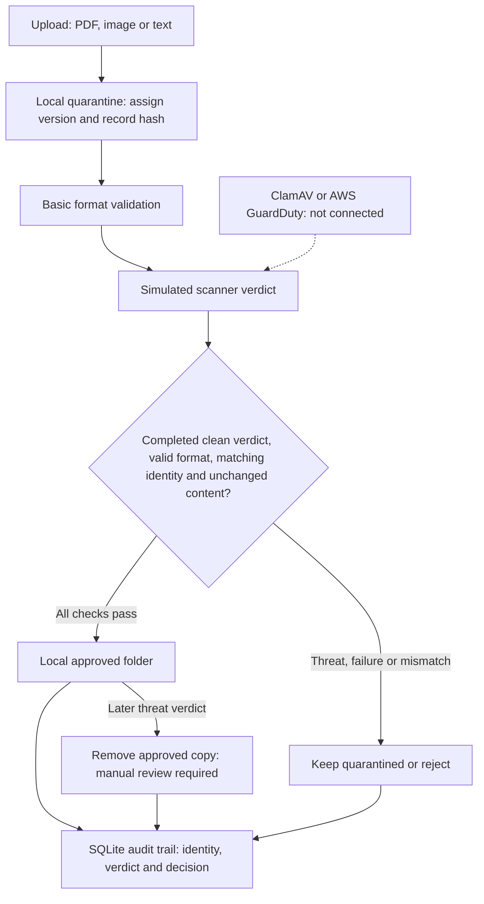

# FileGuard: quarantine and release flow

Controls whether an exact uploaded file can leave quarantine. Solid arrows show implemented paths; the dashed scanner connection is pending. This is an on-demand local prototype, not a production malware scanner.

Example: replacing file contents after a simulated clean verdict changes its hash. FileGuard blocks release even though the earlier verdict was clean.

- Release uses explicit rules, not LLM judgment.
- Scan results are injected test data. No actual antivirus engine is invoked.
- Version, opaque ETag and content hash checks bind the verdict to the uploaded object.
- Failed, unsupported, non-clean and changed-content cases remain blocked.
- SQLite stores metadata and audit events; file content stays on disk.
- Basic header checks are not full document validation. Local event field matching is not authenticated AWS delivery.
- Live S3, GuardDuty, ClamAV, OCR, sandboxing and production database ingestion are not implemented. See FILE_SECURITY.md for deployment requirements.
