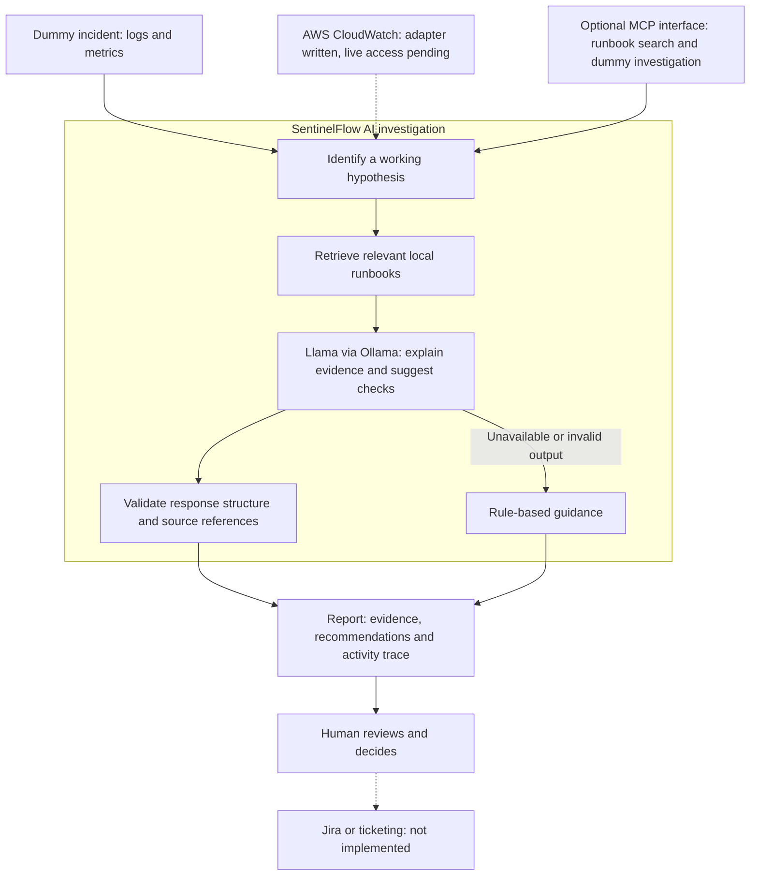

# SentinelFlow AI: investigation flow

Investigates service failures and proposes checks for human review. Solid arrows show implemented paths; dashed arrows show pending live connections. Runs on demand, not as a continuous production service.

Example: failed checkout requests and high database connection usage lead to a database hypothesis. Retrieved guidance helps the LLM recommend inspecting active sessions, connection pools and deployment history.

- Python controls evidence collection, hypothesis selection and reporting.
- RAG uses lexical matching over Markdown runbooks, not embeddings.
- The local LLM supplies advisory explanations. Citation IDs are checked, but a person must assess relevance and correctness.
- Unknown/conflicting evidence suppresses model mitigation suggestions.
- MCP exposes runbook search and dummy investigation tools; it is not automatically registered in a client. Search may be called independently of an investigation.
- The agent does not confirm root cause, execute repairs, or create tickets. Real CloudWatch access remains unverified.
